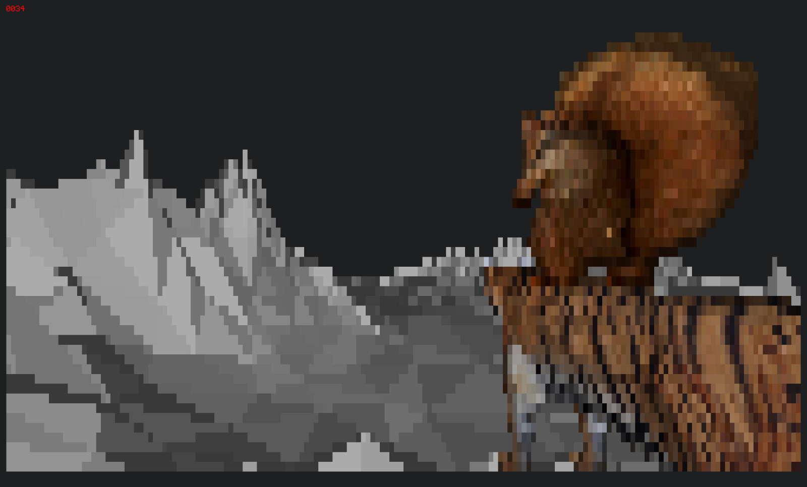
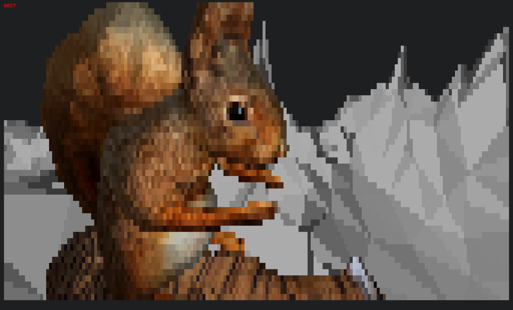

# 3D Terminal Game Engine

A 3D renderer in your terminal. Your terminal must support truecolor and kitty
keyboard protocol. Just use one of these: Ghostty, Kitty, or Alacritty.

## Instructions

Zig version: `0.17.1`.

Clone and run: `zig build run -Doptimize=fast`.

`WASD` -> move

`HJKL` -> rotate camera

`<Space>` -> fly up

`<q>` -> fly down

## Screenshots

